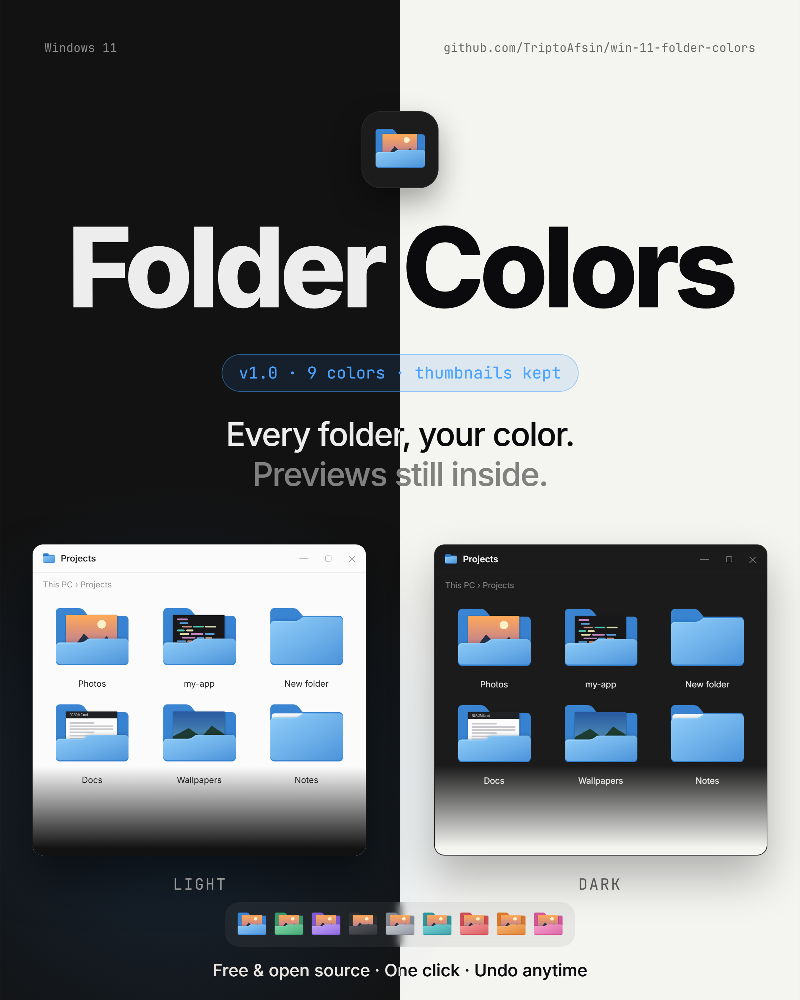
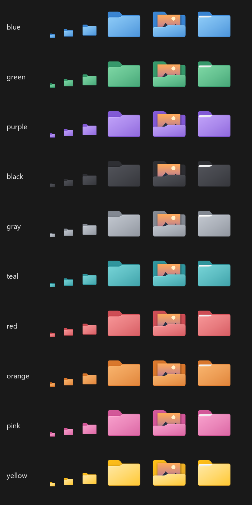
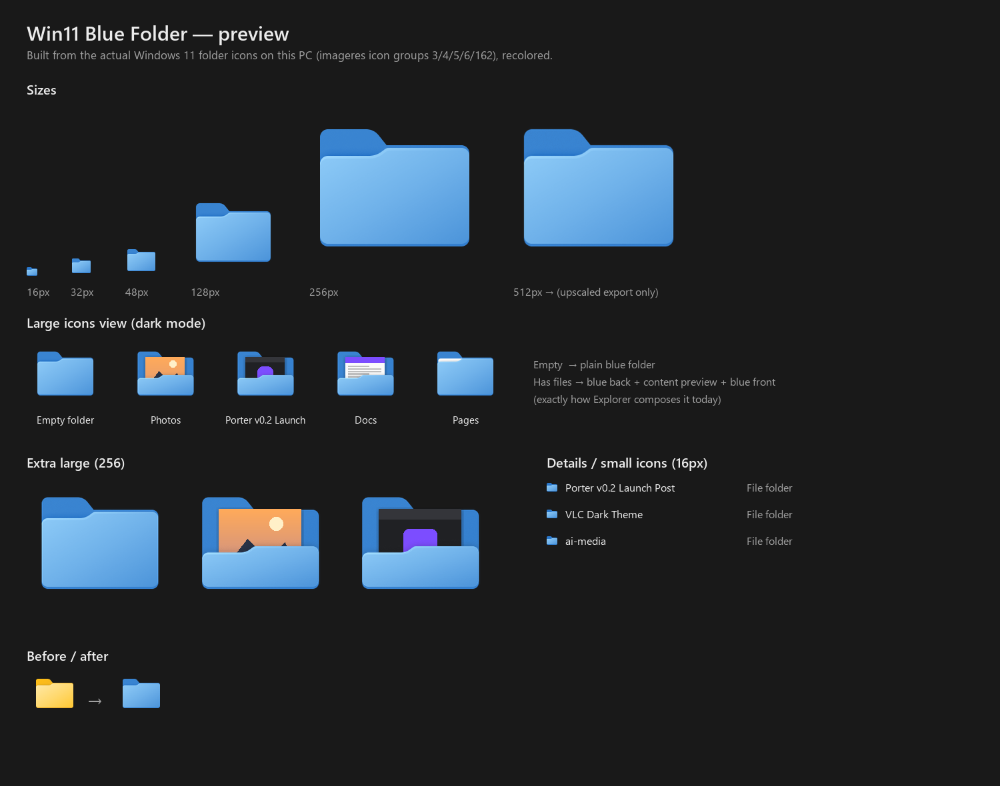

<div align="center">

# Win 11 Folder Colors

**Recolor every folder in Windows 11. The content previews stay.**

Blue · Green · Purple · Black · Gray · Teal · Red · Orange · Pink, with one click to apply and one click to undo.



</div>

---

## Why this exists

Every other way to color folders on Windows (Folder Colorizer, Folder Marker,
*Properties → Customize → Change Icon*) gives each folder a custom icon through
`desktop.ini`. When a folder has a custom icon, Windows 11 stops showing the
little preview of what's inside it. You end up with colored folders that all
look the same.

This project recolors the folder images that Windows itself uses instead.
Every folder changes color at once:

| | Before | After |
|---|---|---|
| Empty folder | stock yellow | plain colored folder |
| Folder with files | yellow + preview | **colored + preview** |
| Small / details view (16 px) | yellow | colored |



<details>
<summary>Explorer mockup (blue)</summary>



</details>

## Install & use

> **Requirements:** Windows 11, [Python 3](https://www.python.org/downloads/) on PATH, admin rights (one UAC prompt).

```powershell
git clone https://github.com/TriptoAfsin/win-11-folder-colors.git
cd win-11-folder-colors
```

1. **Setup (once):** double-click `setup.cmd`. It installs `pillow`, `numpy`
   and `pefile`, and downloads [Resource Hacker](https://www.angusj.com/resourcehacker/)
   from its official site into `tools\`. (`apply.cmd` also runs this for you if you skip it.)
2. **Apply a color:** double-click `apply.cmd` and type a color, or run:
   ```
   apply.cmd blue
   apply.cmd purple
   ```
3. **Undo:** double-click `restore.cmd` to get the stock yellow folders back.

Explorer restarts by itself and the icon and thumbnail caches are cleared. If
a few folders still look yellow, sign out and back in.

### Colors

`blue` `green` `purple` `black` `gray` `teal` `red` `orange` `pink`, plus
`yellow` (stock).

### After a Windows update

A major Windows update, a repair install or `sfc /scannow` puts Windows' own
file back and the folders turn yellow again. Run `apply.cmd <color>` again.
The script sees that the file is new, backs it up and re-applies your color.

## How it works

Explorer draws every folder from five icon groups inside
`C:\Windows\SystemResources\imageres.dll.mun`:

| Group | Role |
|---|---|
| `3`, `4` | Closed folder: empty folders and the small/details view |
| `5` | Back panel of a folder that has files |
| `6` | Front panel. File thumbnails are drawn **between** 5 and 6 |
| `162` | Folder with a sheet of paper |

1. **Back up:** on the first run, the stock file is copied to
   `backup\imageres.dll.mun.original`. Every recolor starts from this copy,
   never from a file that's already been patched.
2. **Recolor:** `folder_colors.py` changes only the amber pixels (hue
   20–70°). Their gradient is remapped by lightness onto the palette, so
   shading, edges and the white paper sheet stay as they were.
3. **Patch a copy:** each size keeps its original format (PNG for 256 px,
   32-bit DIB for the others) and is written into a temp copy with Resource
   Hacker. Win32 `UpdateResource` refuses `.mun` files.
4. **Swap:** `apply.ps1` (elevated) takes temporary ownership of
   `SystemResources`, renames the live file to `imageres.dll.mun.old`, copies
   the new one in, then restores the original permissions.

Sizes in the system file: 16, 20, 24, 32, 40, 48, 64 and 256 px. Explorer
scales 128 down from 256. Windows icons can't be bigger than 256 px.

## Export the icons

Want the colored folders as files, for docs, a dock or another app?

```powershell
python folder_colors.py export            # every color
python folder_colors.py export blue pink  # just these
```

This writes `icons\<color>\folder.ico` (16–256) and `folder-{16,32,48,128,256,512}.png`,
plus "folder with contents" samples. The icons come from **your own**
Windows install, so they aren't in this repo.

## Add your own color

1. Add a `(dark, light)` RGB pair to `PALETTES` in `folder_colors.py`:
   ```python
   "mint": ((0, 120, 96), (160, 240, 214)),
   ```
2. Add `'mint'` to `$colors` in `apply.ps1`.
3. Run `python folder_colors.py export mint` to preview it, then `apply.cmd mint`.

## FAQ

**Is it safe?** It changes one resource-only file, not code. You have two
backups (`backup\` here and `.old` next to the system file), and
`restore.cmd` puts the original back. Still, it does edit a Windows system
file. Use it at your own risk.

**Does it work per folder?** No. It changes every folder on the system, which
is what keeps the previews. If you want different colors for different
folders, use the `.ico` exports with *Change Icon*. Those folders lose their
previews.

**Windows 10?** Not tested. The Windows 10 folder icons and how they're
drawn are different.

**Credits:** the idea of patching `imageres.dll.mun` comes from
[LesFerch/FolderThumbnailFix](https://github.com/LesFerch/FolderThumbnailFix).
Patching uses [Resource Hacker](https://www.angusj.com/resourcehacker/) by Angus Johnson.

## Files

```
apply.cmd / apply.ps1     apply a color (self-elevates)
restore.cmd               back to stock yellow
setup.cmd / setup.ps1     Python deps + Resource Hacker download
folder_colors.py          extract / recolor / patch / export
docs/                     poster + previews used in this README
preview.png               palette sheet, also used as this folder's Explorer thumbnail
backup/  icons/  tools/   created locally, git-ignored
```

## License

[MIT](LICENSE) for the code in this repo. Windows folder artwork is
© Microsoft. Apart from the preview images in `docs/`, it isn't redistributed:
the tool reads it from your own system and writes it back there. Resource
Hacker is freeware with its own licence.
